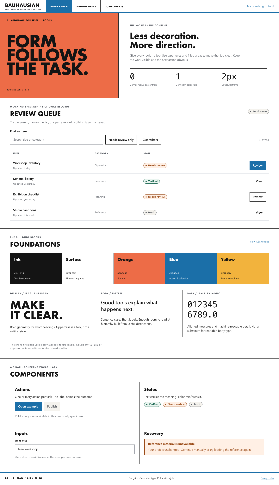

# Bauhausian

**Flat grids. Geometric type. Color with a job.**

A standalone design system for dense tools and inspectable workflows.
White surfaces, orange framing, blue action, hard black rules and square
controls. Maintained by Alex Selig.



## Start here

- [`DESIGN.md`](DESIGN.md) - principles, canonical tokens, layout and behavior.
- [`bauhausian-tokens.css`](bauhausian-tokens.css) - generated CSS variables,
  without global resets or network requests.
- [`components.css`](components.css) - small, framework-independent primitives.
- [`index.html`](index.html) - responsive showcase with working search, filter,
  review dialog and an explicit fictional dataset.
- [`fonts.css`](fonts.css) - optional Google Fonts loading, separate from tokens.

Open `index.html` directly, or serve this directory locally:

```bash
python3 -m http.server 8080 --bind 127.0.0.1
```

Then visit `http://127.0.0.1:8080`. No package install or application server is
needed. No fonts are loaded remotely by default. For the intended League
Spartan / Figtree / IBM Plex Mono typography, include `fonts.css` before
`components.css`, or provide approved self-hosted faces.

## Use in a project

```html
<link rel="stylesheet" href="bauhausian-tokens.css">
<link rel="stylesheet" href="components.css">
<main class="bh" aria-labelledby="title">
  <h1 id="title" class="bh-title">Review queue</h1>
  <button class="bh-button bh-button--primary">Review item</button>
  <span class="bh-status bh-status--success">Verified</span>
</main>
```

The component rules are scoped to `.bh` or `bh-` classes. The tokens use the
established names in `:root`; do not combine this palette with another system
in the same scope without an explicit boundary.

## Update and validate

Python 3.9+ is sufficient:

```bash
python3 build-tokens.py
python3 build-tokens.py --check
python3 -B -m unittest discover -s tests -v
```

Edit the frontmatter in `DESIGN.md`, then regenerate. Unresolved token references
fail the build. `--check` exits nonzero when committed CSS is stale.

Optional browser checks use an existing Playwright installation with Chromium:
`node tests/browser.cjs`. If it is installed outside this repository, set
`PLAYWRIGHT_MODULE` to that installation's absolute module path. These checks
exercise the offline showcase at five widths, filtering, keyboard focus,
dialogs and reduced motion. Screenshots go to the ignored `test-results/`.
Playwright is test-only; the design package itself has no runtime dependencies.

## Scope

This preserves an existing Bauhausian application design language, not its
application implementation. The examples are original and fictional. There
are no customer records, internal endpoints, credentials or application assets.
This repository is a design reference, not a historical Bauhaus reproduction
or a fully accessibility-certified component library.
